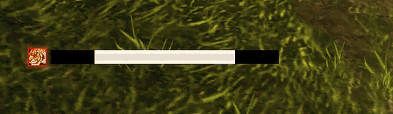

# YaHT Forever – Yet another Hunter Timer

An Auto Shot timer for **WoW Forever** hunters (game version 1.60.x, interface `16001`).
A port of Aviana's classic **YaHT**, rebuilt for Forever's modern client and tuned against real
in-game shot timings. Around the bar it warns you about the deadzone, a resisted Feign Death, the
wrong aspect, and a pet that is low or dead.

## Features
**The bar**
- **Accurate swing bar:** reload, then the red "stand still" wind-up, ending as the shot leaves.
  - Uses Forever's own swing data (`PLAYER_SWING`), with a wind-up that scales with ranged haste.
  - Learns your connection's small per-shot delay and smooths out network jitter.
  - Follows the game's 0.5s retry rhythm when you move, so it stays right while kiting.
- **Countdown:** seconds until the shot (or until you must stand still), to one decimal.
- **Glow, sparks and light sweep:** the glow builds as the reload runs out and is full while you
  must stand still. Uses WeakAuras' glow effects (LibCustomGlow) if you have it installed.
- **Ready pulse:** if you're moving when the shot is ready, lines pulse in the middle until you stop.
- **Melee swing line:** a thin line under the bar that fills with your melee swing, gold while
  Raptor Strike is queued.
- **Quick looks:** Minimal, Clean or Flashy in one click.

**Warnings**
- **Deadzone and too far:** yellow caution stripes in the deadzone, red arrows when out of range.
- **Feign Death resist:** a movable icon with RESIST and a warning sound. It reads the game's
  "Resisted" message, and when there is none it notices from the mob's threat list in a little
  over a second.
- **Aspect badge:** your current aspect next to the bar; red in a fight in Cheetah or Pack, and a
  reminder when you have no aspect.
- **Pet alerts:** movable text for PET LOW, PET DEAD, NO PET and PET NOT ATTACKING.
- **Ammo counter:** hidden while you have plenty, fades in as ammo runs down, then flashes yellow
  and red with a warning sound.

**Proc and cooldown icons**
- **Mongoose Bite** (with its cooldown), **Quick Shots**, **Rapid Fire** and your **racial**.
- Above, left or right of the bar, or anywhere; one shared look, or its own look per icon.

**Options**
- YaHT's own options window: pages on the left, a live preview and a help panel on the right,
  search, a Home page with the main switches, exact X / Y placement with an alignment grid.
- A minimap button with a quick menu, profiles, and a reset button on every page.
- **Tranquilizing Shot announce** to Say, Party, Raid, Raid Warning, Whisper or a channel.

Lightweight: hidden and idle when you're not shooting; well under 1% of a frame when you are.
English, German, Simplified and Traditional Chinese.

## Install
1. Unzip so you end up with `World of Warcraft/_forever_/Interface/AddOns/YaHT/YaHT.toc`.
   The folder must be named exactly `YaHT`.
2. Restart the game and enable **YaHT Forever** in the AddOns list.
3. On first login the bar is unlocked (preview mode). Drag it where you want it, then switch on
   **Lock bar** at the top of the options, or type `/yaht lock`.

## Commands
| Command | What it does |
|---|---|
| `/yaht` | Open or close the options (also the minimap button, and Settings → AddOns) |
| `/yaht lock` / `/yaht unlock` | Lock the bar, or unlock it to move things and preview every effect |
| `/yaht reset` | Move the bar back to the middle of the screen |
| `/yaht grid` | Show or hide the alignment grid |
| `/yaht minimap` | Show or hide the minimap button |
| `/yaht selftest` | Check in the game that everything works, and save a report |
| `/yaht record` | Show the newest lines of the record (pet and aspect warnings, problems) |
| `/yaht ammo` / `/yaht pet` / `/yaht buffs` | Show what YaHT sees of your ammo, pet or buffs |
| `/yaht feign` | Play the Feign Death resist alert once |
| `/yaht debug` | Print shot timings after every Auto Shot |
| `/yaht copy` / `/yaht clear` | Copy the debug log (Ctrl+C), or empty it |
| `/yaht classic` | Open the old options window |
| `/yaht help` | List the commands |

## How the timing works on Forever
- `PLAYER_SWING` gives the exact swing time each shot. The wind-up is
  `0.5s × current speed ÷ weapon base speed`.
- Auto Shot keeps firing during Aimed Shot casts on Forever. If Blizzard changes that back, there's
  a **Casts hold Auto Shot** switch on the Timing page.
- Shots are evenly spaced, but the message about each one arrives up to about 0.1s early or late.
  The bar keeps a steady rhythm instead of jumping with every message.
- If a shot attempt fails (you were moving), the game retries every 0.5s. After you stop, the
  wind-up starts at the next retry moment.
- Extra shot requests the game rejects while a wind-up is already running are ignored.
- Your per-shot delay is learned per character (one saved number). Timing page → **Relearn timing**
  starts over.

## Notes
- Forever hides some things from addons. Pet health is one: PET LOW still works because the game
  draws it, but it can't play a sound. Your own buffs are hidden in a fight, so Quick Shots is
  recognised from your shot speed and the aspect badge remembers the last aspect it saw.
- Forever blocks addons from the combat log, so Tranquilizing Shot is announced on cast; a miss
  can't be detected.
- Say/Yell/Channel announcements from addons only work inside instances, and addon chat is paused
  during boss fights. YaHT skips those quietly.
- If the game says the addon is out of date, check your interface number with
  `/dump select(4, GetBuildInfo())` and put it on the `## Interface:` line of `YaHT.toc`.

## Credits & license
- Original YaHT by **Aviana**: https://github.com/Aviana/YaHT (public domain, see `LICENSE`).
- WoW Forever port and improvements by **Tk Deadeye**.
- Timing research helped by WeaponSwingTimer-SixxFix's Forever branch.
- Bundled Ace3 libraries © Ace3 Development Team (see `libs/Ace3-LICENSE.txt`).
