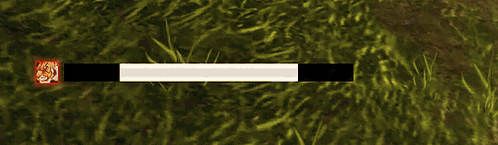

# YaHT Forever – Auto Shot timer for WoW Forever hunters

**Know exactly when to stop moving.** YaHT Forever is a lightweight Auto Shot bar built for WoW
Forever's client, tuned against real in-game shot timings, including while kiting. Around the bar
it warns you about the things that get hunters killed: the deadzone, a resisted Feign Death, the
wrong aspect, a pet that is low or dead.

A port of Aviana's classic **YaHT** (Yet another Hunter Timer). **Original project:** [github.com/Aviana/YaHT](https://github.com/Aviana/YaHT)

## Why it's accurate on Forever
- **Uses the game's own shot signal,** plus a wind-up that scales with your ranged haste.
- **Learns your connection:** it works out the small extra delay between your shots and remembers it.
- **Smooths network jitter:** shots are evenly spaced, but the game's messages aren't. The bar keeps
  a steady rhythm instead of twitching.
- **Kiting-aware:** when moving makes a shot fail, Forever retries every 0.5s. YaHT follows that
  rhythm, so after you stop the red part ends exactly as the arrow leaves.

## Warnings that save you
- **Deadzone and too far:** yellow caution stripes when your target is too close to shoot and too
  far to hit, red arrows pointing you closer when it's out of range.
- **Feign Death resist:** a movable icon with RESIST and a warning sound. It notices a resist in
  a little over a second even when the game shows no "Resisted" message.
- **Aspect badge:** your current aspect next to the bar. Red when a fight starts in Cheetah or Pack,
  and a reminder when you have no aspect at all.
- **Pet alerts:** small movable text for PET LOW, PET DEAD, NO PET and PET NOT ATTACKING.
- **Ammo counter:** invisible while you have plenty, fades in as you run low, then flashes yellow and
  red with a warning sound.

## Proc and cooldown icons
- **Mongoose Bite:** pops in after you dodge, with a gold timer for the window and its cooldown.
- **Quick Shots:** with Deadly Aspects talented, shows while the haste lasts.
- **Rapid Fire and your racial:** show while they last. Your race's active is recognised automatically.
- Place each icon above, left or right of the bar, or drag it anywhere. Give them one shared look
  (size, glow, pulse, sound) or give any icon its own.

## The bar
- **Swing bar:** reload, then the red "stand still" wind-up.
- **Countdown:** time to the shot, or to when you must stand still, to one decimal.
- **Glow, sparks and light sweep:** the glow builds as the reload runs out and is full while you must
  stand still; sparks mark the moving edge. Uses **WeakAuras glow effects** if you have WeakAuras.
- **Ready pulse:** moving with the shot ready? Lines pulse in the middle until you stop.
- **Melee swing line:** a thin line under the bar that fills with your melee swing, only while you're
  in melee. Turns gold while Raptor Strike is queued.
- **Quick looks:** Minimal, Clean or Flashy in one click.
- **Tranquilizing Shot announce** to Say, Party, Raid, Raid Warning, Whisper or a channel.

## An options window that explains itself
- **Live preview:** your bar and icons, drawn from your settings as you change them.
- **Help beside the settings:** point at a setting and the panel on the right says what it does.
- **Search,** a page list on the left, and a Home page with the main switches.
- **Exact placement:** X and Y sliders with single-step arrows, type-in values, and an alignment grid.
- **Lock bar** always in reach at the top, a minimap button with a quick menu, profiles, and a reset
  button on every page.

## Lightweight
- Hidden and doing nothing when you're not shooting.
- Well under 1% of a frame when you are, with no memory build-up.
- The options window is only built when you open it, and only runs while it's open.

## Getting started
1. Install, log in. The bar starts unlocked so you can place it.
2. Drag it where you want it, then switch on **Lock bar** at the top of the options (or type **/yaht lock**).
3. **/yaht** opens the options. So does the minimap button.

| Command | |
|---|---|
| `/yaht` | Open or close the options |
| `/yaht lock` / `unlock` | Lock, or unlock to move things and preview every effect |
| `/yaht reset` | Put the bar back in the middle |
| `/yaht grid` | Show or hide the alignment grid |
| `/yaht selftest` | Check that everything works on your client |
| `/yaht debug` / `copy` | Log shot timings and copy them |

## Notes
- WoW Forever only (interface 16001).
- Forever hides some things from addons. Pet health is one: PET LOW still works because the game
  draws it, but it can't play a sound. The combat log is another: Tranquilizing Shot is announced
  when you cast it, and a miss can't be detected.
- Say/Yell announcements from addons only work inside instances, and addon chat is paused during
  boss fights. That's a game rule.
- Languages: English, German, Simplified and Traditional Chinese. Translation fixes are welcome!

**Bug reports:** type `/yaht selftest` and tell me what it says. For timing problems, turn on
`/yaht debug`, play until it happens, then `/yaht copy` and paste the log in a comment.

*Original [YaHT](https://github.com/Aviana/YaHT) by Aviana (public domain). WoW Forever port, improved by Tk Deadeye.*
